# Bella's Heart

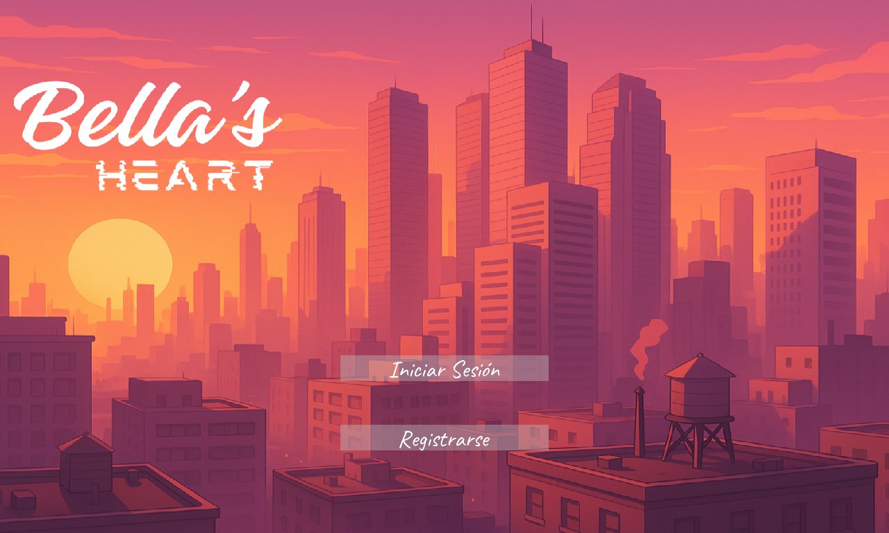

**Bella's Heart** es una novela visual narrativa desarrollada como Trabajo Fin de Grado. El jugador acompaña a Bella y David, una pareja que acaba de mudarse junta, y sus decisiones van moldeando la relación. El objetivo del juego es concienciar sobre la violencia de género: ayudar a reconocer señales de una relación tóxica y dar a conocer los recursos de ayuda disponibles.

Esta es la **versión web**: se juega desde el navegador del móvil o del ordenador y se puede instalar en la pantalla de inicio como una app (PWA), sin pasar por App Store ni Google Play.

### ▶ Jugar: **https://angelalop03.github.io/bellas-heart-web/**

## Instalarlo en el móvil

La primera vez descarga todas las imágenes y la música (unos 55 MB), así que mejor con wifi. Después funciona sin conexión.

**Android (Chrome)**

1. Abre el enlace de arriba en Chrome.
2. Menú ⋮ → **Añadir a pantalla de inicio** (o **Instalar aplicación**).

**iPhone / iPad (Safari)**

1. Abre el enlace en Safari.
2. Botón **Compartir** → **Añadir a pantalla de inicio**.

El juego es horizontal: gira el móvil para jugar. Al tocar un campo de texto se abre un cuadro con el teclado del móvil.

Las cuentas, partidas y decisiones se guardan **solo en ese dispositivo y navegador** (IndexedDB). Borrar los datos del navegador o desinstalar la app borra también las partidas.

## Características

- **Historias por capítulos y escenas**, con personajes, fondos y diálogos ramificados.
- **Decisiones con consecuencias**: cada opción suma puntos emocionales y de relación. Con ellos se calcula el estado psicológico de Bella (`STABLE` → `DISTRESSED`) y el de la relación (`CONFIDENT` → `CRITICAL`), y de ellos depende qué capítulos se desbloquean.
- **Varias partidas por jugador**, que se pueden guardar y retomar desde el capítulo en el que se quedaron.
- **Historial** de las partidas y de las decisiones tomadas.
- **Foro de noticias** sobre violencia de género y **recursos de ayuda** (016, Fundación Ana Bella…).
- **Tutorial** guiado y música de fondo.
- **Panel de administración**: gestión de jugadores, noticias, historias, capítulos y escenas, con un editor visual de decisiones.
- Cuentas con roles (jugador / administrador) y contraseñas cifradas con BCrypt.

## Capturas

### Acceso

<table>
  <tr>
    <td>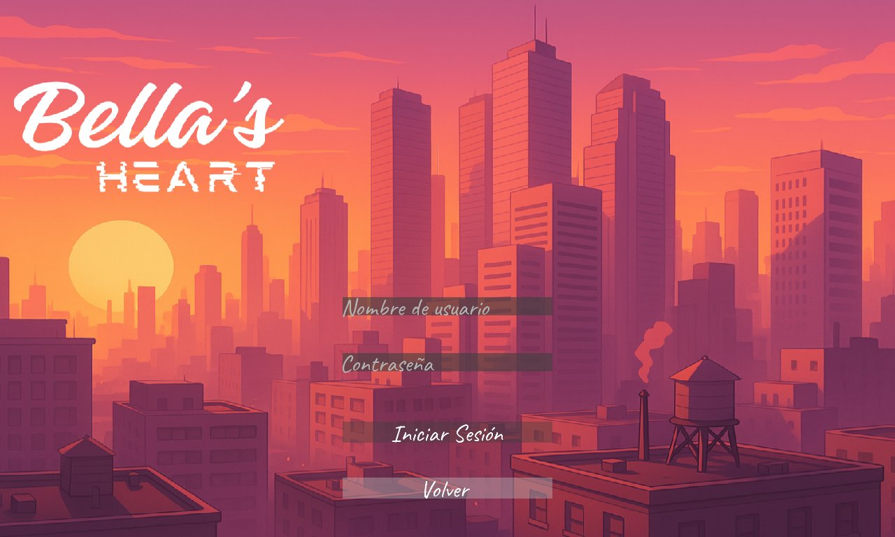</td>
    <td>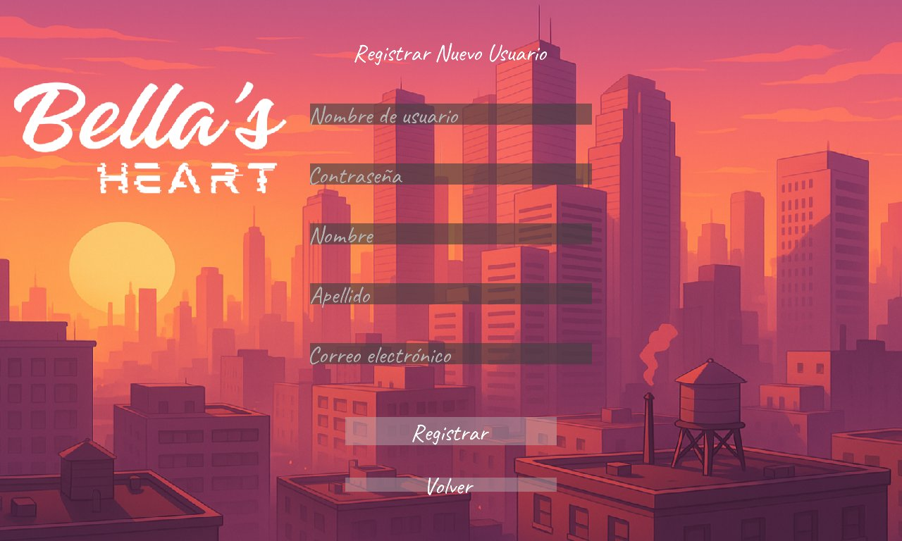</td>
  </tr>
  <tr>
    <td align="center">Inicio de sesión</td>
    <td align="center">Registro</td>
  </tr>
</table>

### Jugador

<table>
  <tr>
    <td>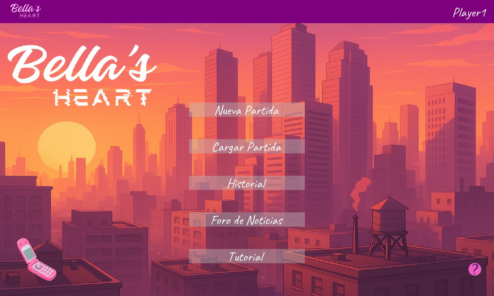</td>
    <td>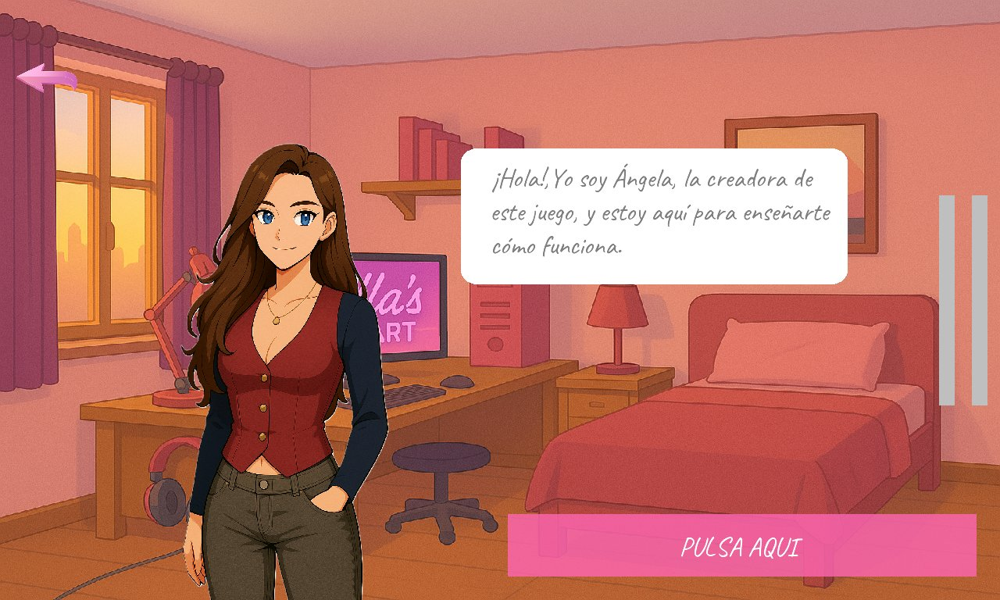</td>
  </tr>
  <tr>
    <td align="center">Menú principal</td>
    <td align="center">Tutorial</td>
  </tr>
  <tr>
    <td>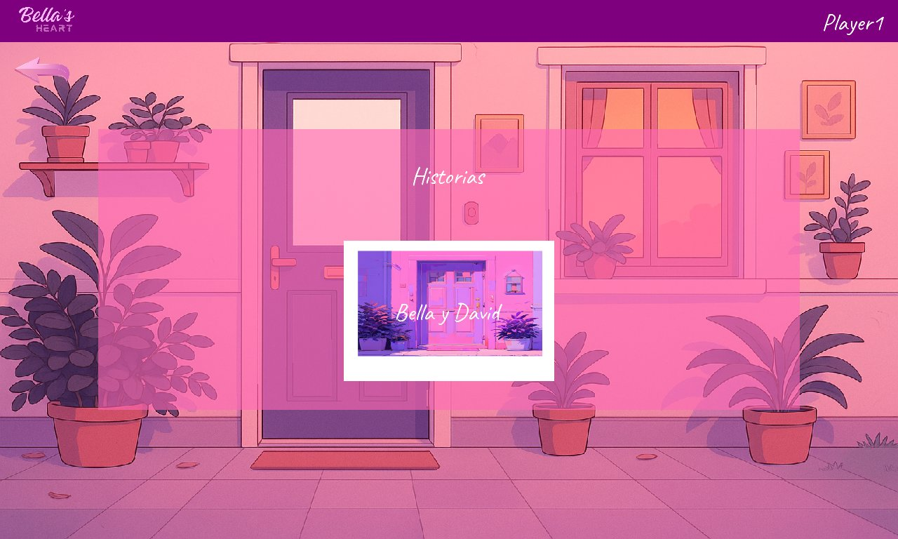</td>
    <td>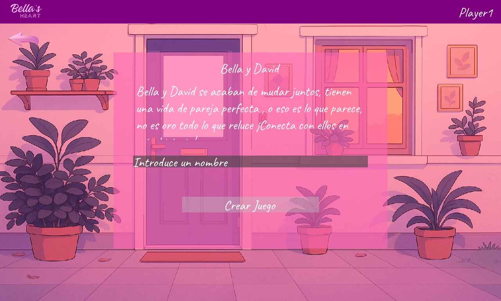</td>
  </tr>
  <tr>
    <td align="center">Nueva partida: elegir historia</td>
    <td align="center">Nueva partida: crear partida</td>
  </tr>
  <tr>
    <td>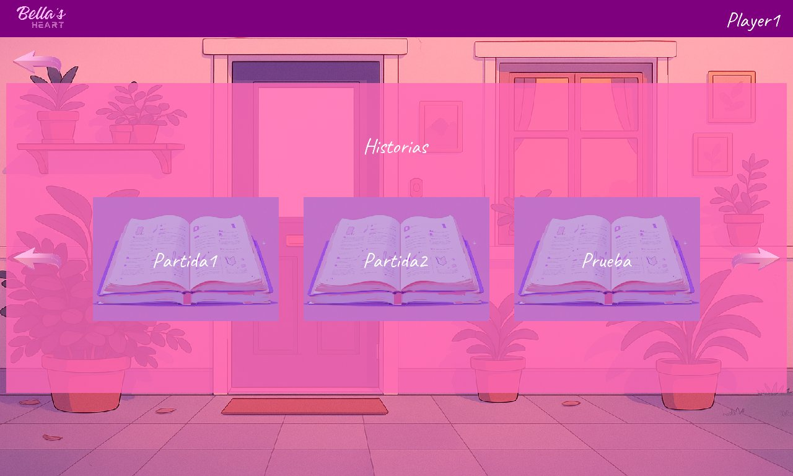</td>
    <td>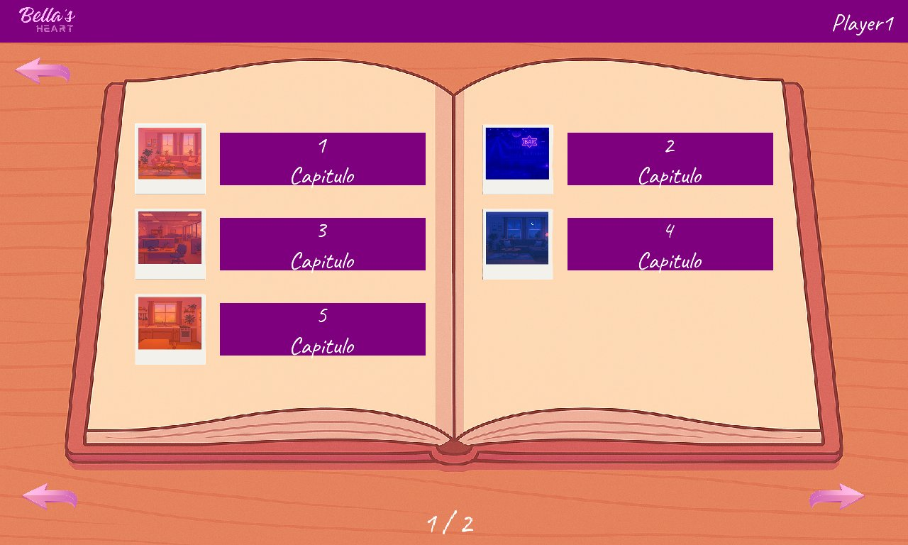</td>
  </tr>
  <tr>
    <td align="center">Cargar partida</td>
    <td align="center">Catálogo de capítulos</td>
  </tr>
  <tr>
    <td colspan="2">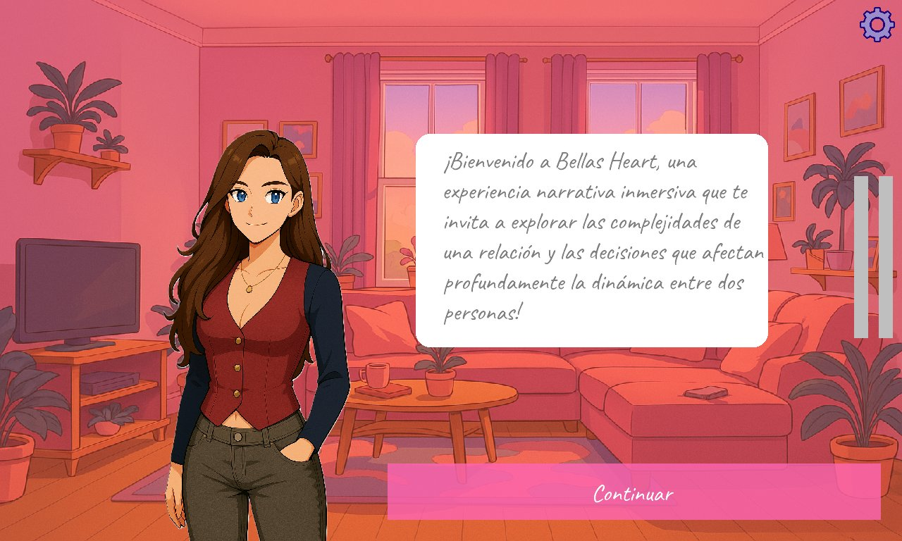</td>
  </tr>
  <tr>
    <td colspan="2" align="center">Escena de juego</td>
  </tr>
  <tr>
    <td>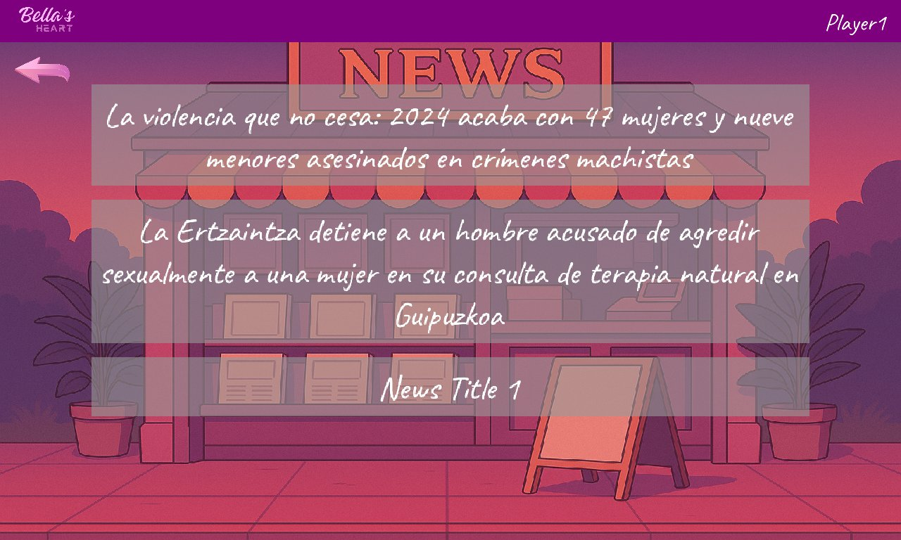</td>
    <td>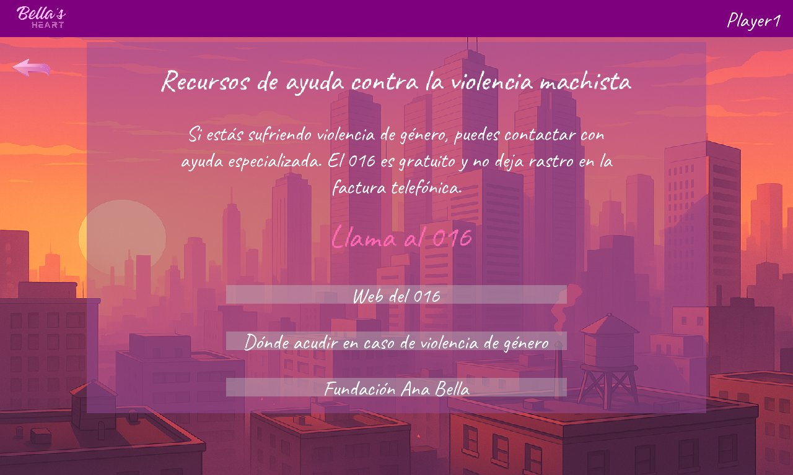</td>
  </tr>
  <tr>
    <td align="center">Foro de noticias</td>
    <td align="center">Recursos de ayuda</td>
  </tr>
  <tr>
    <td colspan="2">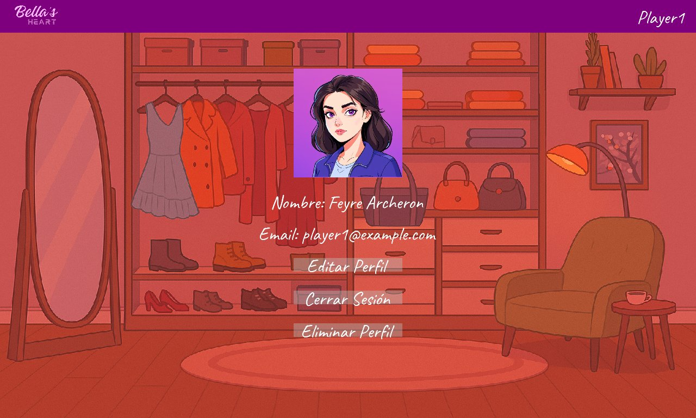</td>
  </tr>
  <tr>
    <td colspan="2" align="center">Perfil</td>
  </tr>
</table>

### Administrador

<table>
  <tr>
    <td>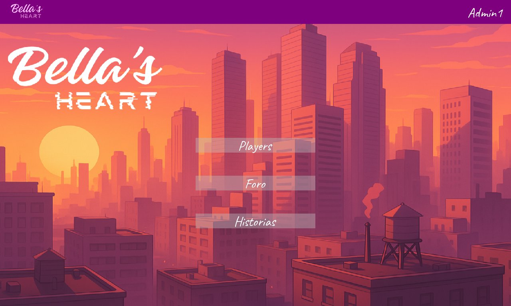</td>
    <td>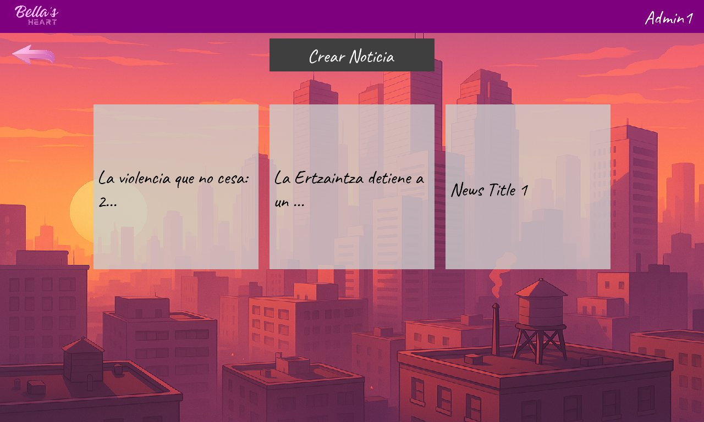</td>
  </tr>
  <tr>
    <td align="center">Menú de administración</td>
    <td align="center">Gestión de noticias</td>
  </tr>
  <tr>
    <td>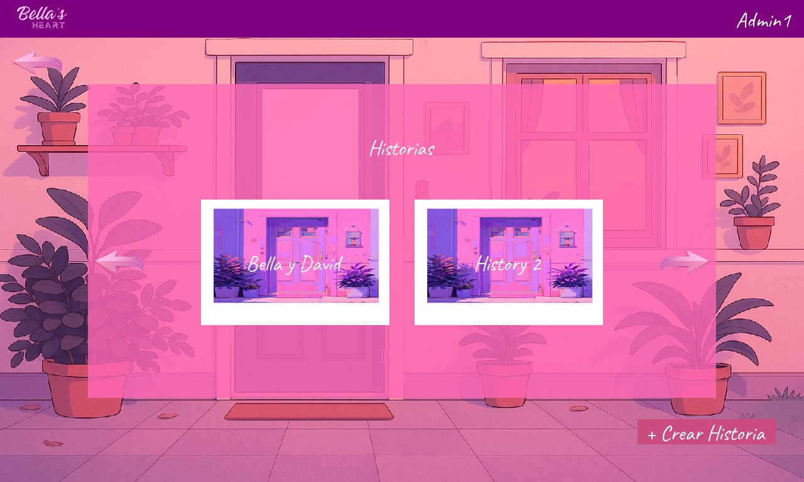</td>
    <td>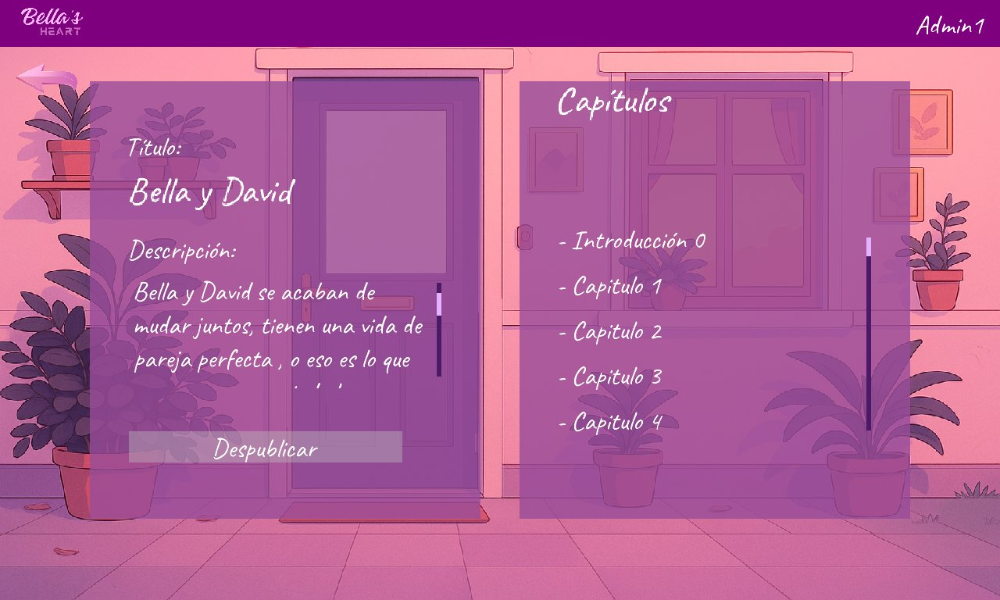</td>
  </tr>
  <tr>
    <td align="center">Gestión de historias</td>
    <td align="center">Detalle de historia y capítulos</td>
  </tr>
  <tr>
    <td colspan="2">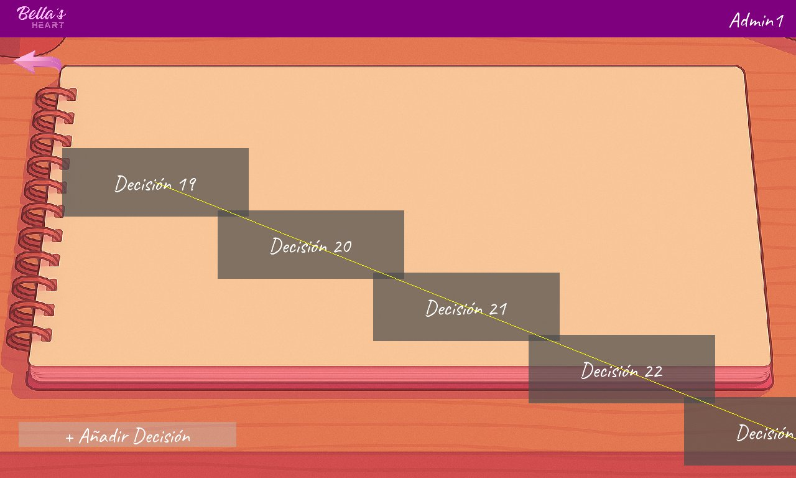</td>
  </tr>
  <tr>
    <td colspan="2" align="center">Editor visual de decisiones de una escena</td>
  </tr>
</table>

## Cómo funciona la versión web

- El código Java del juego se compila a JavaScript con [TeaVM](https://teavm.org/) mediante [gdx-teavm](https://github.com/xpenatan/gdx-teavm) (módulo `web/`).
- La base de datos sigue siendo **SQLite**, pero en el navegador se usa SQLite compilado a WebAssembly ([sql.js](https://sql.js.org/)) y se guarda en IndexedDB. El juego accede a ella a través de unas interfaces propias (`core/.../db`) con dos implementaciones: JDBC en escritorio y sql.js en la web, así que las consultas SQL son las mismas.
- La primera vez se crean las tablas con `assets/schema.sql` y se cargan los datos iniciales de `assets/data.sql`.
- El juego se dibuja a 1280×768 y se escala para caber en cualquier pantalla.
- `web/webapp/` contiene la parte web: `index.html`, el manifest y el service worker de la PWA, el puente con sql.js (`bellas-db.js`) y el cuadro de texto para el teclado del móvil (`bellas-keyboard.js`).
- Cada push a `main` compila y publica la web en GitHub Pages (`.github/workflows/deploy.yml`).

## Tecnologías

- Java y [libGDX](https://libgdx.com/) 1.14.2 (backend web con gdx-teavm y backend de escritorio LWJGL3)
- SQLite: `sqlite-jdbc` en escritorio y sql.js (WebAssembly) en el navegador
- jBCrypt para el cifrado de contraseñas
- JUnit 4, Mockito y JaCoCo para los tests
- Gradle y [Construo](https://github.com/fourlastor-alexandria/construo) para empaquetar el juego por plataforma

## Estructura del proyecto

```
core/      Lógica del juego compartida
  model/     Entidades (User, Player, Game, History, Chapter, Scene, Decision…)
  manager/   Acceso a datos y lógica de negocio
  screens/   Pantallas: General (inicio, login, registro), Player y Admin
  utils/     Base de datos, recursos, estilos de la interfaz…
  db/        Acceso a SQLite independiente de la plataforma (JDBC o sql.js)
web/       Versión web / PWA (TeaVM + sql.js)
lwjgl3/    Lanzador de escritorio (útil para desarrollar)
assets/    Imágenes, fuentes, música, esquema (schema.sql) y datos iniciales (data.sql)
```

## Cómo ejecutarlo

Requisitos: JDK 17 o superior.

### Web (en local)

```bash
gradlew web:gdx_teavm_web_js_run
```

Abre http://localhost:8080. Para generar la versión optimizada que se publica:

```bash
gradlew web:gdx_teavm_web_js_release_build
```

El resultado queda en `web/build/dist/js/release/webapp` y se puede subir a cualquier hosting estático (GitHub Pages, Netlify, Vercel…).

### Escritorio

```bash
gradlew lwjgl3:run
```

La base de datos se crea sola la primera vez en `%APPDATA%\BellasHeart\game.db`.

### Otras tareas de Gradle

- `core:test`: ejecuta los tests unitarios y genera el informe de cobertura de JaCoCo en `core/build/reports/jacoco/test/html`.
- `lwjgl3:packageWinX64` (también `packageLinuxX64`, `packageMacM1` y `packageMacX64`): empaqueta el juego de escritorio con un JDK incluido mediante Construo.
- `clean`: elimina las carpetas `build`.
